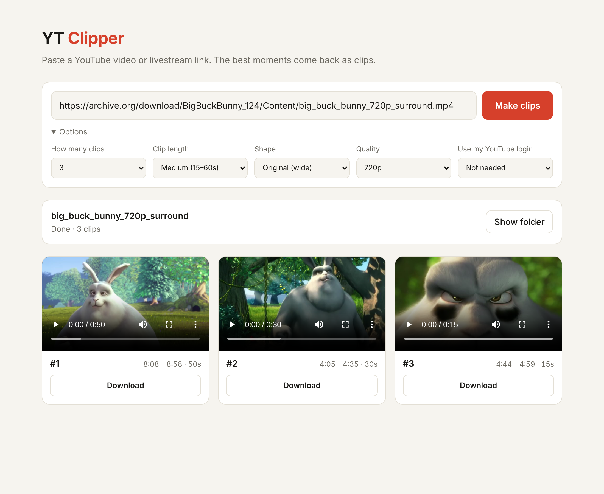

# YT Clipper

Paste a YouTube video or livestream link and get its best moments back as clips.
Runs on your own computer, in your browser.



## Start it

**Mac:** double-click `YTClipper.command`. The first run sets everything up, then the app
opens in your browser. (It uses Homebrew to install Python 3.10+, `ffmpeg` and `node` if they are missing; macOS's built-in Python is too old.)

**Any computer** (needs Python 3.10+, `ffmpeg`, and `node` or `deno`):

```bash
pip install -e .
```

```bash
ytclipper ui
```

Clips are saved in `~/YTClipper/clips`. Livestream links are detected automatically: the
app watches the stream and adds clips as big moments happen, until you press Stop.

Every clip is vertical, 1080×1920, ready for Shorts, Reels and TikTok.

**Facecam on top.** If the streamer's webcam is in the picture, it is found automatically
and placed across the top of the clip with the gameplay underneath. Detection looks for a
face that stays in one spot while the game moves, framed by edges that do not move either.
Without a facecam the clip is a centre crop (shifted to keep a person on screen in frame).

**Animated captions.** Words are drawn onto the clip at full resolution, a few at a time,
with a red box sweeping in behind the word being spoken — the look and timing of
[HyperFrames](https://github.com/heygen-com/hyperframes)' `caption-highlight` style.
YouTube's own captions are used when the video has them; otherwise the speech is
transcribed on your computer.

If YouTube answers "Sign in to confirm you're not a bot" (common on servers and VPNs), open
Options and choose your browser under "Use my YouTube login".

## How it finds "good scenes"

Every second of the video gets a highlight score built from several signals:

| Signal    | Source                                                    | Used for        |
|-----------|-----------------------------------------------------------|-----------------|
| `heatmap` | YouTube's "most replayed" graph                           | videos          |
| `chat`    | chat messages per second (live chat replay)               | past streams    |
| `speech`  | captions: fast talking, hype words, [Laughter]/[Applause] | videos          |
| `audio`   | loudness spikes (shouting, cheering, explosions)          | videos + live   |
| `voice`   | where people are talking (when there are no captions)     | videos          |
| `scenes`  | rate of hard cuts (opt-in, `--scenes`)                    | videos          |

Each signal is normalised against the video's own typical level, weighted (audience
signals count most) and combined. The highest peaks become clips, widened to include the
build-up, and their edges are nudged to the nearest quiet moment so cuts do not land
mid-sentence.

**Choosing what is actually good.** Those signals only say that *something* happened. So the
tool shortlists twice as many moments as you asked for, listens to each one (speech-to-text),
moves its start and end to sentence boundaries, and then ranks them by what is said:

- **With Claude** — add an Anthropic API key under Options in the app (or set
  `ANTHROPIC_API_KEY`). Claude reads each candidate like an editor would, rates it 1–10 as a
  standalone clip, drops the duds, and writes a title for each. Uses `claude-opus-5-5`; one
  request per video. The key is stored in `~/.ytclipper.json`, readable only by you.
- **Without a key** — a simple heuristic favours lively speech (reactions, questions, hype words).

**Why it is fast:** only the audio track is downloaded for analysis, then only the chosen
clip ranges of the video are fetched and cut, in parallel. A three-hour stream does not
need a three-hour download.

## Use it from a Claude chat (no API key)

Claude can run YT Clipper for you from the Claude desktop app, on your normal Claude
plan: no API key and no per-clip cost. You paste a link in a chat; Claude finds the
moments, reads what is said in each, picks the good ones as an editor would, titles
them, and the clips are made on your computer.

**Set up once (Mac):**

1. Install the Claude desktop app from https://claude.ai/download and sign in.
2. Double-click **`Connect to Claude.command`** in this folder. It sets everything up (the
   same way `YTClipper.command` does) and adds YT Clipper to the Claude app's settings,
   keeping a backup of them.
3. Quit the Claude app completely (Cmd-Q) and open it again.

Keep this folder where it is: the Claude app runs YT Clipper from here.

**Use it:** in a new chat, ask for example

> Make 3 clips from https://www.youtube.com/watch?v=...

The first time, the Claude app asks to allow YT Clipper's tools; allow them. Claude
reports progress while the video is analysed (a few minutes for long videos), tells you
which moments it picked and why, and gives you the files, saved in `~/YTClipper/clips`.
Ask it to "open the clips folder" to see them in Finder.

To remove it: `.venv/bin/ytclipper connect-claude --remove`, then restart the Claude app.

Claude Code users can add it with:

```bash
claude mcp add ytclipper -- /full/path/to/yt-clipper/.venv/bin/ytclipper mcp
```

Tools: `find_moments` and `make_clips` start background jobs, `check_job` waits for one
and returns candidates or files, `open_clips_folder` shows the results.

## Command line

```bash
ytclipper clip "https://www.youtube.com/watch?v=VIDEO_ID" -n 5 -o clips/
```

```bash
ytclipper analyze "https://www.youtube.com/watch?v=VIDEO_ID" --json
```

```bash
ytclipper live "https://www.youtube.com/watch?v=LIVE_ID" -o clips/
```

Every command also accepts a local media file instead of a URL.

## Layout

- `server.py`, `web/index.html` – the browser app
- `mcp_server.py` – tools for Claude in the chat
- `connect.py` – adds those tools to the Claude desktop app
- `judge.py` – Claude rates and titles the candidates
- `captions.py` – speech-to-text and the animated caption renderer
- `facecam.py` – finds a streamer's webcam overlay
- `render.py` – vertical layout and encoding
- `source.py` – yt-dlp downloads; heatmap, chat and caption signals
- `media.py` – ffmpeg: loudness, scene cuts
- `scoring.py` – normalise/combine signals, pick and snap clip windows
- `pipeline.py` – analyse + export for finished videos
- `live.py` – segment recorder and online spike detector for livestreams

## Tests

```bash
pip install -e '.[dev]'
pytest
```

## Roadmap

- Live chat rate as a signal in live mode (currently loudness only)
- Round or borderless (green-screen) facecams, which have no frame to detect
- Follow the action in the gameplay crop instead of a fixed centre crop

Only clip content you have the rights to use.

The caption font is Montserrat (SIL Open Font License); the face detector is OpenCV's
YuNet model (MIT). Both are bundled in `src/ytclipper/assets`.
